 

 

 

 

 

As a Computer Science & Engineering student at **NED University of Engineering & Technology**, I bridge rigorous engineering with product thinking. I enjoy owning features end to end — from data model and API design to the final hover state — and I care deeply about performance, accessibility and code that the next developer will thank me for.

### Experience & Education

| | | |
|:--|:--|:--|
| `2025 — Now` | **Full-Stack Web Developer** | Freelance & Product Studios |
| `2024` | **Frontend Engineering Intern** | SaaS Startup |
| `2021 — 2025` | **B.E., Computer Science & Engineering** | NED University of Engineering & Technology |

 

### GitHub, in numbers

<picture>
  <source media="(prefers-color-scheme: dark)" srcset="https://raw.githubusercontent.com/rohn-ahmad/rohn-ahmad/output/github-snake-dark.svg"/>
  
</picture>

 

