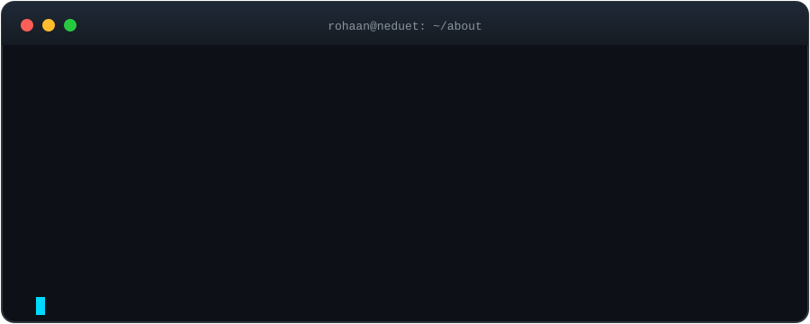
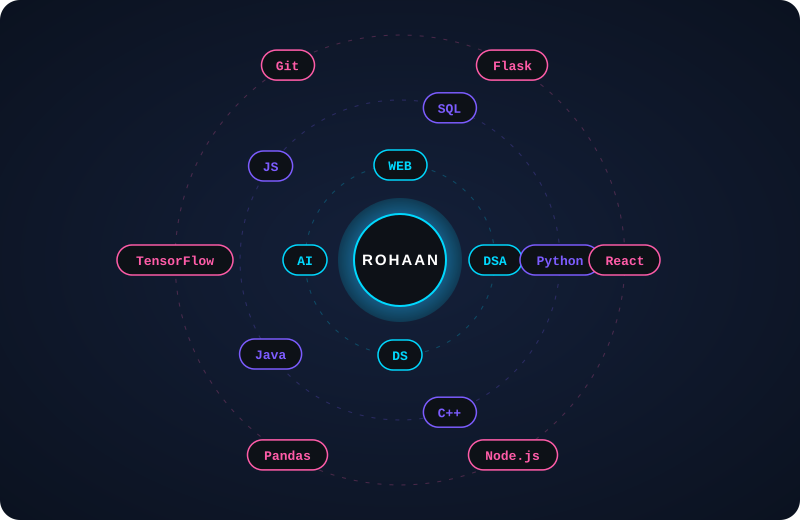

<div align="center">



<br/>

<a href="https://git.io/typing-svg"></a>

<br/>


[](https://www.linkedin.com/in/rohaanahmad0/)
[](mailto:rohaanahmad21dec@gmail.com)
[](https://rohaanahmad.vercel.app/)
[](https://leetcode.com/YOUR_USERNAME)
[](https://kaggle.com/YOUR_USERNAME)

</div>


## 👨‍💻 &nbsp;About Me

<div align="center">

</div>

<br/>

<table>
<tr>
<td width="50%" valign="top">

### 🎓 Education
**BE — Computer Science & Engineering**
NED University of Engineering & Technology (NEDUET)
📍 Karachi, Pakistan

### 🧭 Focus Areas
- 🧩 Data Structures & Algorithms
- 📊 Data Science & Analytics
- 🤖 Artificial Intelligence & ML
- 🌐 Full-Stack Web Development

</td>
<td width="50%" valign="top">

### ⚡ Quick Facts
- 🔭 Building projects at the intersection of **AI, data & the web**
- 🧠 Strong command of **DSA** and competitive problem-solving
- 🌱 Currently exploring **deep learning & system design**
- 🤝 Open to **internships, collaborations & open source**
- 💬 Ask me about **algorithms, ML models, or React**

</td>
</tr>
</table>


## 🛰️ &nbsp;Tech Universe

<div align="center">

</div>

<br/>

<div align="center">

| 🧩 DSA | 📊 Data Science | 🤖 AI / ML | 🌐 Web Dev |
|:---:|:---:|:---:|:---:|
| Arrays · Strings · Hashing | Pandas · NumPy | scikit-learn | React · Next.js |
| Trees · Graphs · Heaps | EDA & Cleaning | TensorFlow · PyTorch | Node · Express |
| DP · Greedy · Backtracking | Matplotlib · Seaborn | Model Evaluation | REST APIs · Auth |
| Big-O Analysis | Feature Engineering | Neural Networks | MongoDB · PostgreSQL |

</div>

<details>
<summary><b>🧰 Full Toolbox (click to expand)</b></summary>
<br/>

<div align="center">

**Languages**<br/>


**Web**<br/>


**AI / Data**<br/>


**Tools**<br/>


</div>
</details>


## 🚀 &nbsp;Featured Projects

<div align="center">

<a href="https://github.com/YOUR_USERNAME/SmartCrete"></a>
<a href="https://github.com/YOUR_USERNAME/VCAPS"></a>
<a href="https://github.com/YOUR_USERNAME/PROJECT_3"></a>
<a href="https://github.com/YOUR_USERNAME/PROJECT_4"></a>

</div>

| Project | What it does | Stack |
|:--|:--|:--|
| 🏗️ **SmartCrete** | ML model that predicts concrete compressive strength from mix parameters | `Python` `scikit-learn` `Pandas` |
| 🚦 **VCAPS** | Urban traffic congestion analysis tool built on Karachi road data | `Python` `Data Analysis` |
| 🌐 **Project 3** | Describe your best full-stack web app here | `React` `Node.js` `MongoDB` |
| 🧮 **Project 4** | DSA vault / visualizer / competitive programming toolkit | `C++` `Python` |


## 📊 &nbsp;GitHub Analytics

<div align="center">


<br/>


</div>

## 🐍 &nbsp;Contribution Snake

<div align="center">
<picture>
  <source media="(prefers-color-scheme: dark)" srcset="https://raw.githubusercontent.com/rohn-ahmad/rohn-ahmad/output/github-snake-dark.svg"/>
  <source media="(prefers-color-scheme: light)" srcset="https://raw.githubusercontent.com/rohn-ahmad/rohn-ahmad/output/github-snake.svg"/>
  
</picture>
</div>


## 🗺️ &nbsp;Roadmap

```diff
+ Mastering advanced algorithms & competitive programming
+ Building production-grade ML pipelines
+ Learning system design & scalable backends
+ Contributing to open-source projects
- Procrastination.exe (deprecated)
```

## 💡 &nbsp;Philosophy

```js
const rohaan = {
  code:     "clean, readable, efficient",
  mindset:  "break it, understand it, rebuild it better",
  strength: ["DSA", "Data Science", "AI", "Web Dev"],
  motto:    "Code. Break. Learn. Repeat.",
};
```

<br/>

<div align="center">

### ⭐ Like what you see? Star a repo, say hi, or let's build something together.


</div>
